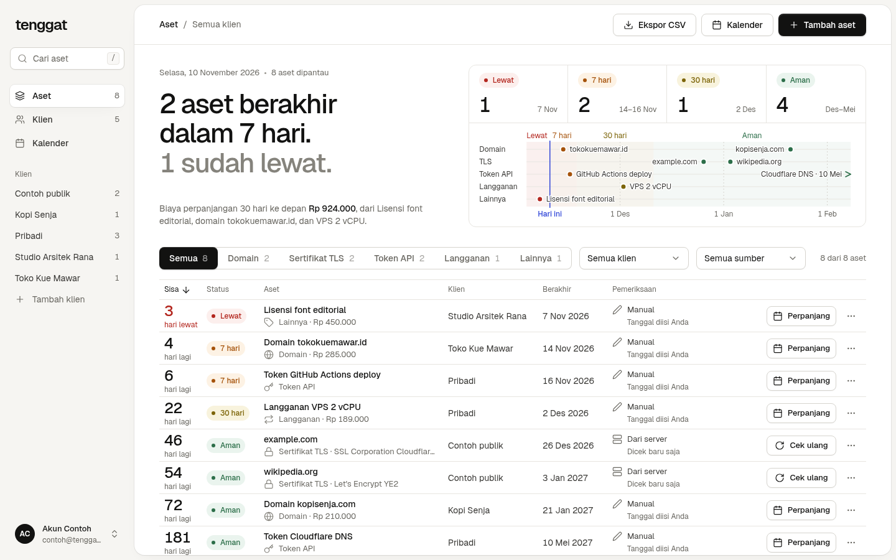
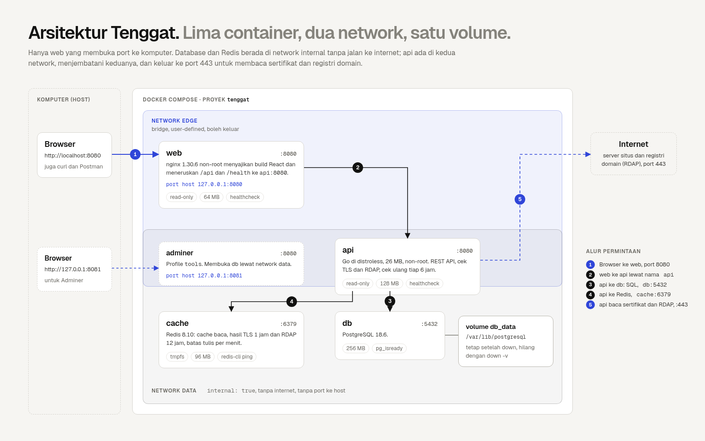
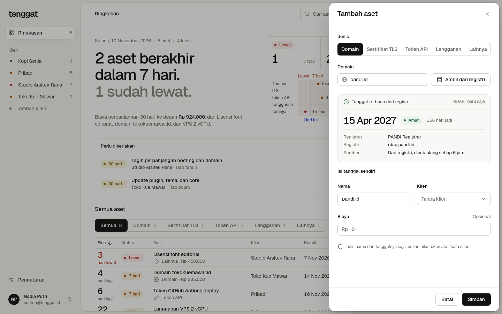
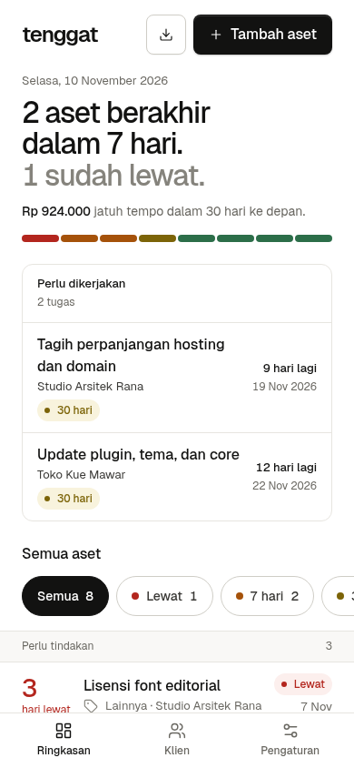
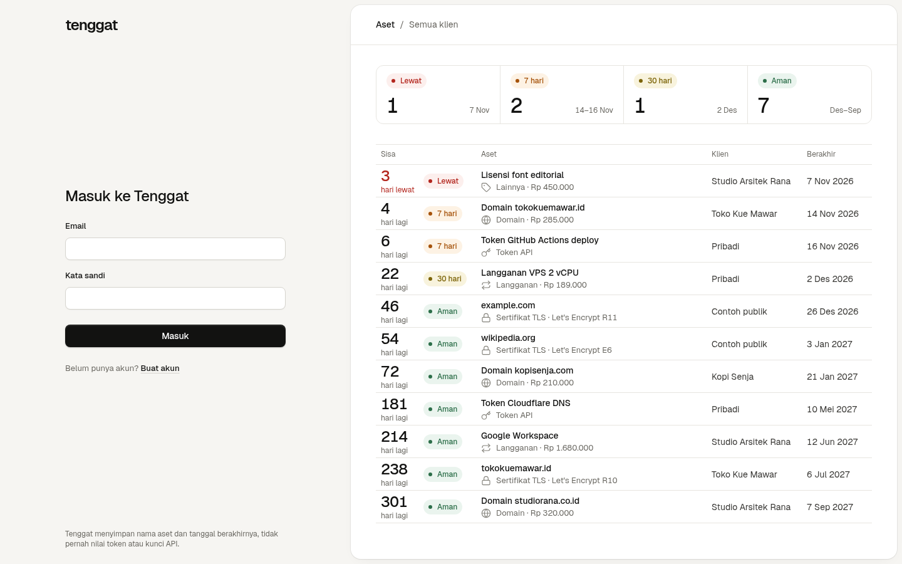
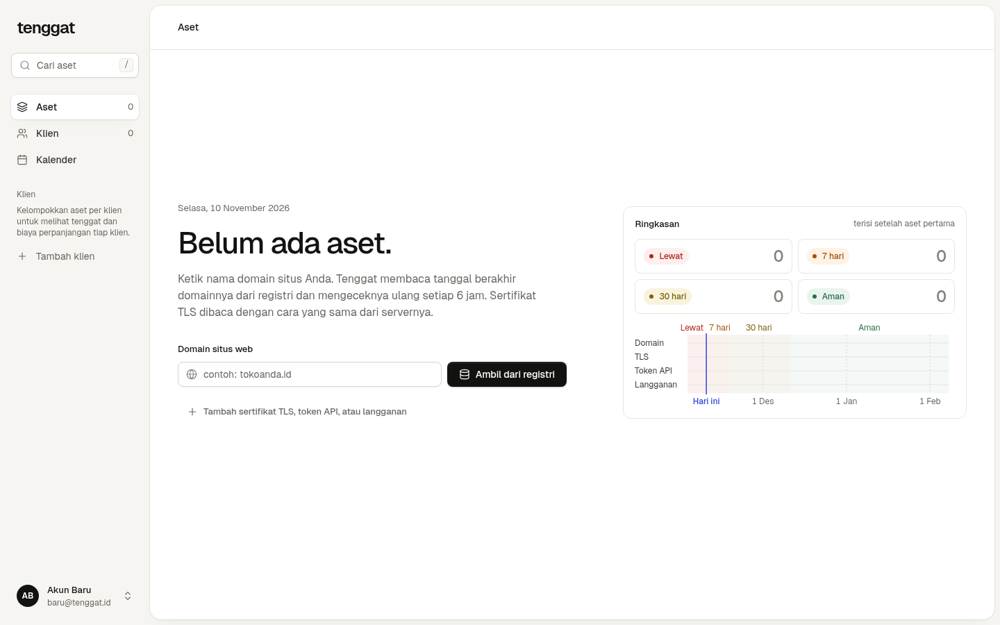

# Tenggat

Masa berlaku domain, sertifikat TLS, token API, dan langganan dalam satu daftar. Untuk situs, Anda cukup mengisi nama
host: Tenggat membaca tanggal berakhir sertifikat langsung dari server, mengeceknya ulang tiap 6 jam, dan mengingatkan
sebelum ada yang kedaluwarsa.

Coba versi online di https://tenggat.mrramdn.com, atau jalankan di komputer Anda sendiri (lihat
[Menjalankan](#menjalankan)).



## Latar belakang

Tanggal kedaluwarsa aset digital biasanya tersebar di email registrar, dashboard penyedia cloud, dan catatan pribadi.
Begitu satu tanggal terlewat, situs tidak bisa dibuka, browser menampilkan peringatan "Not secure", integrasi putus,
atau layanan ditangguhkan. Tenggat dibuat untuk freelancer dan agensi kecil yang mengurus banyak situs klien, UMKM
yang punya website atau toko online, dan tim IT kecil.

## Fitur

- Akun: daftar, masuk, keluar, dan hapus akun. Setiap pengguna hanya melihat asetnya sendiri.
- Satu daftar aset dengan status otomatis dari sisa hari: **Lewat**, **7 hari**, **30 hari**, **Aman**.
- Sertifikat TLS dibaca langsung dari server (port 443) dan dicek ulang berkala; kegagalan cek ikut tercatat.
- Tanggal berakhir domain dibaca dari registri lewat RDAP (`.com`, `.net`, `.org`, `.id` termasuk `.co.id`, dan TLD
  lain yang punya RDAP), juga dicek ulang berkala. TLD tanpa RDAP, misalnya `.io`, diisi tanggalnya sendiri.
- Kalender `.ics` dengan pengingat 30 dan 7 hari sebelumnya: unduh sekali, atau tautan langganan pribadi supaya
  aplikasi kalender di ponsel ikut memperbarui sendiri.
- Ekspor CSV seluruh aset.
- Filter per status dan klien, ringkasan jumlah per status.
- Daftar klien sendiri: tambah, ubah, dan hapus klien, lengkap dengan jumlah aset dan biaya perpanjangan 30 hari.
- Hanya menyimpan nama dan tanggal aset; nilai token atau kata sandi layanan tidak pernah disimpan.
- Host yang mengarah ke alamat lokal atau privat ditolak, sehingga fitur cek tidak bisa dipakai untuk mengintip
  jaringan internal (SSRF).

## Arsitektur



| Service | Image | Port di host | Network | Volume |
|---|---|---|---|---|
| web | build `web/` (nginx 1.30.6 unprivileged) | 127.0.0.1:8080 | edge | - |
| api | build `api/` (distroless static) | - | edge, data | - |
| db | postgres:18.6-alpine3.24 | - | data | db_data |
| cache | redis:8.10.3-alpine3.23 | - | data | - (tmpfs) |
| adminer (profile `tools`) | adminer:6.3.0 | 127.0.0.1:8081 | edge, data | - |

Hanya `web` yang dibuka ke host. Network `data` bertanda `internal`, jadi database dan Redis tidak punya jalan ke
internet. `api` ada di kedua network: menerima permintaan dari nginx dan keluar ke port 443 untuk membaca sertifikat.

## Menjalankan

Butuh Docker Engine dengan Docker Compose.

```bash
git clone https://github.com/mrramdn/tenggat.git
cd tenggat
cp .env.example .env
docker compose up -d --build
```

Buka http://localhost:8080, lalu buat akun di halaman Daftar. Untuk mengisi data contoh:
`./scripts/isi-data-contoh.sh` membuat akun `contoh@tenggat.id` dengan kata sandi `contoh-tenggat` (hanya untuk
mencoba di komputer Anda) dan menambahkan delapan aset.

Image `web` dan `api` juga ada di Docker Hub dengan tag `1.0.0` dan `latest`:
[mrramdn/tenggat-web](https://hub.docker.com/r/mrramdn/tenggat-web) dan
[mrramdn/tenggat-api](https://hub.docker.com/r/mrramdn/tenggat-api). Untuk memakainya tanpa build, ganti perintah
terakhir dengan `docker compose pull web api && docker compose up -d`.

Adminer (opsional): `docker compose --profile tools up -d`, lalu buka http://127.0.0.1:8081. Pilih System
**PostgreSQL**, server `db`, lalu user, kata sandi, dan database dari `.env`.

Data database disimpan di volume `tenggat_db_data`: `docker compose down` mempertahankannya, `docker compose down -v`
menghapusnya.

## Tampilan

| Tambah aset: sertifikat dibaca dari server | Ponsel |
|---|---|
|  |  |

Halaman masuk dan daftar:



Saat belum ada aset, halaman awal langsung meminta host pertama:



## Konfigurasi (`.env`)

| Variabel | Bawaan | Fungsi |
|---|---|---|
| `WEB_PORT` | 8080 | Port di komputer Anda untuk membuka Tenggat |
| `POSTGRES_DB`, `POSTGRES_USER`, `POSTGRES_PASSWORD` | tenggat, tenggat, - | Database; wajib diisi (compose berhenti dengan pesan bila kosong) |
| `CEK_INTERVAL` | 6h | Seberapa sering sertifikat dicek ulang |
| `BATAS_PER_MENIT` | 30 | Batas permintaan tulis dan cek sertifikat per klien per menit |
| `ADMINER_PORT` | 8081 | Port Adminer (profile `tools`) |

## API

Semua lewat http://localhost:8080 (nginx meneruskan ke `api`). Selain `/health`, `POST /api/akun`, dan
`POST /api/sesi`, setiap endpoint butuh sesi (cookie `tenggat_sesi`) dan menjawab `401` tanpanya.

| Method dan path | Fungsi | Status |
|---|---|---|
| `GET /health` | Kesehatan api, database, dan cache | 200, 503 |
| `POST /api/akun` | Daftar akun baru dan langsung masuk | 201, 400, 409, 422, 429 |
| `POST /api/sesi` | Masuk | 200, 401, 422, 429 |
| `DELETE /api/sesi` | Keluar | 204 |
| `GET /api/saya` | Akun yang sedang masuk | 200, 401 |
| `DELETE /api/saya` | Hapus akun beserta semua asetnya | 204, 401 |
| `GET /api/item?status=&klien=&klien_id=` | Daftar aset, urut tenggat terdekat | 200, 422 |
| `POST /api/item` | Tambah aset; sertifikat dibaca dari server | 201 + `Location`, 400, 422, 429 |
| `GET /api/item/{id}` | Satu aset | 200, 404 |
| `PUT /api/item/{id}` | Ubah aset, misalnya setelah diperpanjang | 200, 404, 422 |
| `DELETE /api/item/{id}` | Hapus aset | 204, 404 |
| `POST /api/item/{id}/cek` | Cek ulang sertifikat atau domain dari registri sekarang | 200, 404, 422, 429 |
| `GET /api/sertifikat?host=` | Pratinjau sertifikat sebelum disimpan | 200, 422, 429 |
| `GET /api/domain?host=` | Pratinjau tanggal domain dari registri (RDAP) | 200, 422, 429 |
| `GET /api/item.csv` | Semua aset sebagai CSV | 200 |
| `GET /api/ringkasan` | Jumlah aset per status dan daftar klien | 200 |
| `GET /api/kalender.ics` | File kalender untuk semua aset | 200 |
| `POST /api/kalender/tautan` | Buat atau ganti tautan langganan kalender | 201 |
| `DELETE /api/kalender/tautan` | Cabut tautan langganan | 204 |
| `GET /api/kalender/{token}.ics` | Kalender lewat tautan langganan, tanpa sesi | 200, 404, 429 |
| `GET /api/klien` | Daftar klien dengan jumlah aset, tenggat terdekat, dan biaya 30 hari | 200 |
| `POST /api/klien` | Tambah klien (`nama`, `catatan`) | 201 + `Location`, 409, 422, 429 |
| `PUT /api/klien/{id}` | Ubah nama atau catatan klien | 200, 404, 409, 422 |
| `DELETE /api/klien/{id}` | Hapus klien; asetnya tetap ada, tanpa klien | 204, 404 |

Domain yang dikirim dengan `host` tanpa `kedaluwarsa` dibaca dari registri (`sumber: "registri"`); kalau tanggalnya
diisi, aset itu manual. Token tautan kalender hanya tampil sekali dan disimpan sebagai hash SHA-256, seperti token sesi.

Aset menerima `klien_id` atau `klien` (nama). Nama yang belum ada menjadi klien baru, `""` berarti tanpa klien. Nama
klien unik per akun tanpa membedakan huruf besar dan kecil.

Contoh dengan curl (cookie sesi disimpan di `sesi.txt`):

```bash
curl -i -c sesi.txt -X POST http://localhost:8080/api/akun \
  -H 'Content-Type: application/json' \
  -d '{"nama":"Rifki","email":"rifki@contoh.id","kata_sandi":"minimal-delapan"}'

curl -i -b sesi.txt -X POST http://localhost:8080/api/item \
  -H 'Content-Type: application/json' \
  -d '{"jenis":"sertifikat","klien":"Pribadi","host":"example.com"}'
```

`GET /api/item`, `GET /api/ringkasan`, dan `GET /api/klien` membawa header `X-Cache: HIT` atau `MISS` dari Redis.

## Data dan privasi

- Yang disimpan: nama dan email akun, hash kata sandi, sesi, dan metadata aset (nama layanan, jenis, klien, host,
  tanggal, biaya, catatan). Nilai token API atau kata sandi layanan tidak pernah diminta maupun disimpan.
- Kata sandi disimpan sebagai hash Argon2id (19 MiB, 2 putaran). Token sesi acak 256 bit; database hanya menyimpan
  SHA-256-nya, cookie-nya `HttpOnly` dan `SameSite=Lax` (dan `Secure` di HTTPS), berlaku 30 hari, dan dicabut saat
  keluar.
- Permintaan yang mengubah data dari situs lain ditolak (`403`), dan percobaan masuk serta pendaftaran dibatasi per
  pengunjung.
- Klien disimpan dengan nama dan catatan. Bila catatan berisi nama kontak, isi seperlunya; klien bisa dihapus kapan
  saja dan asetnya tetap ada tanpa klien.
- Untuk membaca tanggal, api menghubungi server situs (port 443) dan registri domain (RDAP lewat HTTPS). Yang dikirim
  hanya nama host atau domain.
- Tautan langganan kalender berisi token acak; database hanya menyimpan SHA-256-nya, dan tautan bisa diganti atau
  dicabut kapan saja.
- Hapus akun menghapus akun, sesi, klien, dan semua aset pengguna itu sekaligus.

## Pengembangan

```bash
cd api && go test ./...            # Go 1.26 atau lebih baru
cd web && pnpm install && pnpm dev # Vite meneruskan /api ke http://localhost:8080
```

## Struktur folder

```
api/        layanan Go: cmd/server, internal/{expiry,tlscheck,store,cache,httpapi}, Dockerfile
web/        React + Vite + TypeScript, nginx.conf, Dockerfile
scripts/    isi-data-contoh.sh untuk data contoh
docs/       diagram dan screenshot README
docker-compose.yml, .env.example
```

## Kredit

- [pgx](https://github.com/jackc/pgx), [go-redis](https://github.com/redis/go-redis), [x/crypto](https://pkg.go.dev/golang.org/x/crypto) (Argon2id), [x/net](https://pkg.go.dev/golang.org/x/net) (publicsuffix, idna)
- Data bootstrap RDAP dari [IANA](https://data.iana.org/rdap/dns.json), disalin ke `api/internal/rdap/dns.json`
- [React](https://react.dev), [Vite](https://vite.dev), [TanStack Query](https://tanstack.com/query)
- Huruf [Geist dan Geist Mono](https://vercel.com/font) (SIL Open Font License 1.1, `web/src/assets/fonts/OFL.txt`)
- Image dasar resmi: golang, node, nginxinc/nginx-unprivileged, gcr.io/distroless/static, postgres, redis, adminer

<!-- tautan video dan artikel menyusul -->
