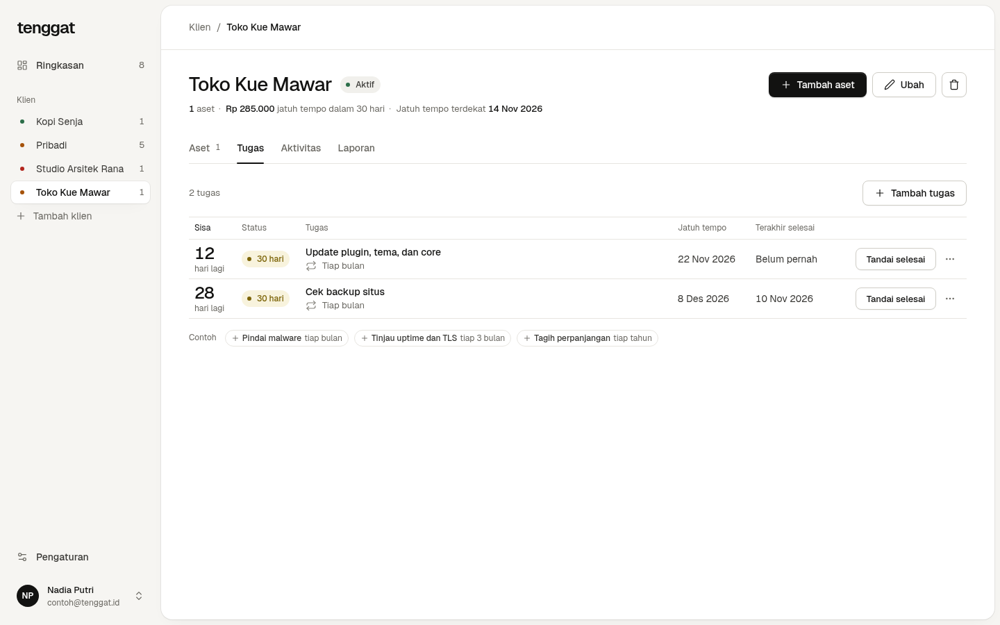
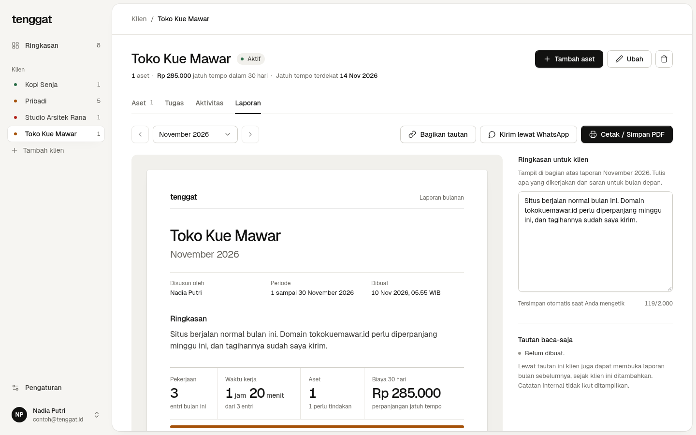
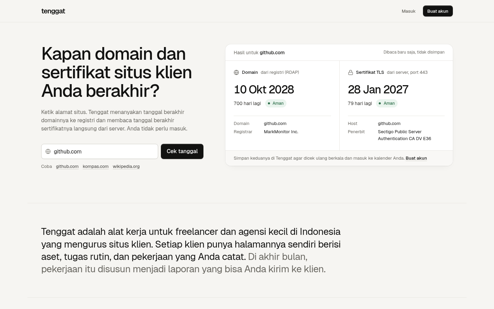

# Tenggat

Tenggat dibuat untuk freelancer dan agensi kecil yang mengurus situs klien. Setiap klien punya halaman sendiri: aset
(domain, sertifikat TLS, token API, langganan) beserta tanggal berakhirnya, tugas maintenance yang berulang, catatan
pekerjaan, dan laporan bulanan yang bisa dikirim ke klien. Tanggal domain dibaca dari registri dan tanggal sertifikat
dari server, lalu dicek ulang tiap 6 jam.

Coba versi online di https://tenggat.mrramdn.com, atau jalankan di komputer Anda sendiri (lihat
[Menjalankan](#menjalankan)).


## Latar belakang

Tanggal berakhir domain, sertifikat, dan token tersebar di email registrar, dashboard penyedia cloud, dan catatan
pribadi. Satu tanggal yang terlewat berarti situs tidak bisa dibuka, browser menampilkan peringatan "Not secure", atau
layanan ditangguhkan. Bagi yang menjual paket maintenance bulanan, ada pekerjaan rutin lain (backup, update plugin,
cek keamanan) dan laporan yang dikirim ke klien tiap bulan, biasanya lewat WhatsApp atau PDF. Tenggat menyatukan
keduanya per klien.

## Fitur

- **Halaman depan** dengan cek langsung: ketik alamat situs, lalu lihat tanggal berakhir domain (registri) dan
  sertifikatnya (server) tanpa membuat akun.
- **Halaman per klien** dengan tab Aset, Tugas, Aktivitas, dan Laporan. Ringkasan lintas klien tetap ada di `/app`.
- **Aset** dengan status dari sisa hari: Lewat, 7 hari, 30 hari, Aman. Domain dibaca lewat RDAP (`.com`, `.net`,
  `.org`, `.id` termasuk `.co.id`, dan TLD lain yang punya RDAP); TLD tanpa RDAP, misalnya `.io`, diisi tanggalnya
  sendiri. Sertifikat dibaca dari port 443. Keduanya dicek ulang berkala, dan kegagalan cek ikut tercatat.
- **Tugas maintenance berulang**, misalnya cek backup tiap bulan. Setelah ditandai selesai, jatuh temponya maju ke
  periode berikutnya dan pekerjaannya masuk ke aktivitas klien.
- **Aktivitas** per klien: catatan internal, catatan pekerjaan dengan durasi, dan kejadian yang dicatat otomatis (aset
  ditambah atau diperpanjang, tanggal berubah saat cek ulang, tugas selesai).
- **Laporan bulanan** per klien: pekerjaan dan waktu kerja bulan itu, perpanjangan, daftar aset, dan yang jatuh tempo
  60 hari ke depan, plus ringkasan yang Anda tulis. Bisa dicetak atau disimpan sebagai PDF, dibagikan lewat tautan baca-saja yang bisa
  dicabut, atau dikirim lewat WhatsApp. Catatan internal tidak pernah ikut.
- **Pengingat ke klien** lewat WhatsApp untuk aset yang mendekati tanggalnya (tautan `wa.me` berisi teks; nomor telepon
  tidak disimpan).
- **Kalender** `.ics` dengan pengingat 30 dan 7 hari sebelumnya: unduh sekali, atau tautan langganan pribadi supaya
  aplikasi kalender ikut memperbarui sendiri.
- **Ringkasan harian** pukul 08.00 WIB ke Slack, Discord, atau Telegram lewat webhook milik Anda, bila ada aset atau
  tugas yang lewat atau jatuh tempo dalam 7 hari.
- Ekspor CSV, akun dengan data terpisah per pengguna, dan penolakan host yang mengarah ke alamat lokal atau privat
  (SSRF).

## Arsitektur


| Service | Image | Port di host | Network | Volume |
|---|---|---|---|---|
| web | `mrramdn/tenggat-web:1.0.0`, build dari `web/` (nginx 1.30.6 unprivileged) | 127.0.0.1:8080 | edge | - |
| api | `mrramdn/tenggat-api:1.0.0`, build dari `api/` (distroless static) | - | edge, data | - |
| db | postgres:18.6-alpine3.24 | - | data | db_data |
| cache | redis:8.10.3-alpine3.23 | - | data | - (tmpfs) |
| adminer (profile `tools`) | adminer:6.3.0 | 127.0.0.1:8081 | edge, data | - |

Hanya `web` yang dibuka ke host. Network `data` bertanda `internal`, jadi database dan Redis tidak punya jalan ke
internet. `api` ada di kedua network: menerima permintaan dari nginx, dan keluar ke port 443 untuk membaca sertifikat,
menanyai registri domain, dan mengirim notifikasi webhook.

## Menjalankan

Butuh Docker Engine dengan Docker Compose.

```bash
git clone https://github.com/mrramdn/tenggat.git
cd tenggat
cp .env.example .env
docker compose up -d --build
```

Buka http://localhost:8080, lalu pilih Buat akun. Untuk mengisi data contoh, `./scripts/isi-data-contoh.sh` membuat
akun `contoh@tenggat.id` dengan kata sandi `contoh-tenggat` (hanya untuk mencoba di komputer Anda) beserta delapan aset,
empat tugas, catatan pekerjaan, dan ringkasan laporan bulan ini.

Image `web` dan `api` juga ada di Docker Hub dengan tag `1.0.0` dan `latest`:
[mrramdn/tenggat-web](https://hub.docker.com/r/mrramdn/tenggat-web) dan
[mrramdn/tenggat-api](https://hub.docker.com/r/mrramdn/tenggat-api). Untuk memakainya tanpa build, ganti perintah
terakhir dengan `docker compose pull web api && docker compose up -d`.

Adminer (opsional): `docker compose --profile tools up -d`, lalu buka http://127.0.0.1:8081. Pilih System
**PostgreSQL**, server `db`, lalu user, kata sandi, dan database dari `.env`.

Data database disimpan di volume `tenggat_db_data`: `docker compose down` mempertahankannya, `docker compose down -v`
menghapusnya.

## Tampilan

| Halaman klien: tugas maintenance | Laporan bulanan |
|---|---|
|  |  |

| Halaman depan dengan cek langsung | Ponsel |
|---|---|
|  |  |

Menambah aset: tanggal domain dibaca dari registri.


## Konfigurasi (`.env`)

| Variabel | Bawaan | Fungsi |
|---|---|---|
| `WEB_PORT` | 8080 | Port di komputer Anda untuk membuka Tenggat |
| `POSTGRES_DB`, `POSTGRES_USER`, `POSTGRES_PASSWORD` | tenggat, tenggat, - | Database; wajib diisi (compose berhenti dengan pesan bila kosong) |
| `CEK_INTERVAL` | 6h | Seberapa sering sertifikat dan domain dicek ulang |
| `BATAS_PER_MENIT` | 30 | Batas permintaan tulis dan cek per pengunjung per menit |
| `ADMINER_PORT` | 8081 | Port Adminer (profile `tools`) |

## API

Semua lewat http://localhost:8080 (nginx meneruskan ke `api`). Kecuali yang ditandai *publik*, setiap endpoint butuh
sesi (cookie `tenggat_sesi`) dan menjawab `401` tanpanya. Kesalahan isian dijawab `422` dengan pesan per kolom.

| Method dan path | Fungsi | Status |
|---|---|---|
| `GET /health` (publik) | Kesehatan api, database, dan cache | 200, 503 |
| `GET /api/publik/cek?host=` (publik) | Cek tanggal domain dan sertifikat untuk halaman depan | 200, 422, 429 |
| `POST /api/akun` (publik) | Daftar akun baru dan langsung masuk | 201, 409, 422, 429 |
| `POST /api/sesi` (publik), `DELETE /api/sesi` | Masuk, keluar | 200, 401, 422, 429 / 204 |
| `GET /api/saya`, `DELETE /api/saya` | Akun yang sedang masuk; hapus akun beserta semua datanya | 200 / 204 |
| `GET /api/item?status=&klien_id=`, `POST /api/item` | Daftar aset; tambah aset (domain dan sertifikat dibaca otomatis bila tanggal kosong) | 200 / 201 + `Location`, 422, 429 |
| `GET`, `PUT`, `DELETE /api/item/{id}` | Satu aset: lihat, ubah (misalnya setelah diperpanjang), hapus | 200, 404, 422 / 204 |
| `POST /api/item/{id}/cek` | Cek ulang sertifikat atau domain sekarang | 200, 404, 422, 429 |
| `GET /api/sertifikat?host=`, `GET /api/domain?host=` | Pratinjau tanggal sebelum disimpan | 200, 422, 429 |
| `GET /api/item.csv`, `GET /api/ringkasan` | Semua aset sebagai CSV; jumlah per status | 200 |
| `GET /api/klien`, `POST /api/klien` | Daftar klien dengan jumlah aset, jatuh tempo terdekat, biaya 30 hari; tambah klien | 200 / 201, 409, 422 |
| `PUT`, `DELETE /api/klien/{id}` | Ubah nama, catatan, atau status klien; hapus klien (asetnya tetap ada) | 200, 404, 409, 422 / 204 |
| `GET /api/tugas?klien_id=&dalam_hari=`, `POST /api/tugas` | Tugas maintenance berulang | 200 / 201 + `Location`, 422 |
| `PUT`, `DELETE /api/tugas/{id}`, `POST /api/tugas/{id}/selesai` | Ubah, hapus, tandai selesai (jatuh tempo maju satu periode) | 200, 404, 409, 422 / 204 |
| `GET /api/aktivitas?klien_id=&sebelum=`, `POST /api/aktivitas`, `DELETE /api/aktivitas/{id}` | Aktivitas klien; tulis catatan atau pekerjaan; hapus catatan atau pekerjaan | 200 / 201 / 204, 422 |
| `GET /api/klien/{id}/laporan?bulan=`, `PUT /api/klien/{id}/laporan/catatan` | Laporan bulanan; ringkasan Anda untuk bulan itu | 200, 404, 422 |
| `POST`, `DELETE /api/klien/{id}/laporan/tautan` | Buat atau ganti, dan cabut tautan laporan | 201 / 204 |
| `GET /api/laporan/{token}?bulan=` (publik) | Laporan lewat tautan baca-saja | 200, 404, 422, 429 |
| `GET /api/kalender.ics?klien_id=`, `POST`, `DELETE /api/kalender/tautan` | File kalender; buat atau cabut tautan langganan | 200 / 201 / 204 |
| `GET /api/kalender/{token}.ics` (publik) | Kalender lewat tautan langganan | 200, 404, 429 |
| `GET`, `PUT`, `DELETE /api/notifikasi`, `POST /api/notifikasi/uji` | Webhook Slack, Discord, atau Telegram; kirim pesan uji | 200, 422, 502 / 204 |

Domain yang dikirim dengan `host` tanpa `kedaluwarsa` dibaca dari registri (`sumber: "registri"`); bila tanggalnya
diisi, aset itu manual. Aset dan tugas menerima `klien_id` atau `klien` (nama); nama yang belum ada menjadi klien baru.

Contoh dengan curl (cookie sesi disimpan di `sesi.txt`):

```bash
curl -i -c sesi.txt -X POST http://localhost:8080/api/akun \
  -H 'Content-Type: application/json' \
  -d '{"nama":"Rifki","email":"rifki@contoh.id","kata_sandi":"minimal-delapan"}'

curl -i -b sesi.txt -X POST http://localhost:8080/api/item \
  -H 'Content-Type: application/json' \
  -d '{"jenis":"domain","klien":"Pribadi","host":"mrramdn.com"}'

curl -i -b sesi.txt -X POST http://localhost:8080/api/tugas \
  -H 'Content-Type: application/json' \
  -d '{"klien":"Toko Kue Mawar","judul":"Cek backup situs","ulang_jumlah":1,"ulang_satuan":"bulan","jatuh_tempo":"2026-12-01"}'
```

`GET /api/item`, `GET /api/ringkasan`, dan `GET /api/klien` membawa header `X-Cache: HIT` atau `MISS` dari Redis.

## Data dan privasi

- Yang disimpan: nama dan email akun, hash kata sandi, sesi, klien (nama, catatan, status), aset (nama, jenis, host,
  tanggal, biaya, catatan), tugas, dan aktivitas. Tenggat tidak pernah meminta atau menyimpan token dan kata sandi dari
  aset yang dilacak.
- Satu-satunya rahasia yang disimpan adalah URL webhook notifikasi yang Anda isi sendiri. URL itu hanya dipakai untuk
  mengirim ringkasan harian dan pesan uji, tidak pernah ditampilkan utuh atau ditulis ke log, dan terhapus saat notifikasi dimatikan atau
  akun dihapus.
- Catatan klien dan aktivitas bisa memuat nama kontak; isi seperlunya. Catatan internal tidak pernah masuk laporan.
- Tautan laporan dan tautan kalender berisi token acak. Database hanya menyimpan SHA-256-nya, tautannya bisa diganti atau
  dicabut kapan saja, dan halaman laporan meminta mesin pencari tidak mengindeksnya.
- Kata sandi disimpan sebagai hash Argon2id. Token sesi acak 256 bit, database hanya menyimpan SHA-256-nya, cookie-nya
  `HttpOnly` dan `SameSite=Lax` (dan `Secure` di HTTPS), berlaku 30 hari, dan dicabut saat keluar.
- Untuk membaca tanggal, api menghubungi server situs dan registri domain; yang dikirim hanya nama host atau domain.
  Cek di halaman depan tidak menyimpan apa pun.
- Permintaan yang mengubah data dari situs lain ditolak (`403`). Masuk, daftar, tulis, dan cek dibatasi per pengunjung.
- Hapus akun menghapus akun, sesi, klien, aset, tugas, aktivitas, dan pengaturan notifikasi sekaligus.

## Pengembangan

```bash
cd api && go test ./...            # Go 1.26 atau lebih baru
cd web && pnpm install && pnpm dev # Vite meneruskan /api ke http://localhost:8080
```

## Struktur folder

```
api/        layanan Go: cmd/server, internal/{expiry,tlscheck,rdap,store,cache,auth,httpapi}, Dockerfile
web/        React + Vite + TypeScript, nginx.conf, Dockerfile
scripts/    isi-data-contoh.sh untuk data contoh
docs/       diagram, screenshot README, dan salinan artikel (GitHub Pages)
docker-compose.yml, .env.example
```

## Kredit

- [pgx](https://github.com/jackc/pgx), [go-redis](https://github.com/redis/go-redis), [x/crypto](https://pkg.go.dev/golang.org/x/crypto) (Argon2id), [x/net](https://pkg.go.dev/golang.org/x/net) (publicsuffix, idna)
- Data bootstrap RDAP dari [IANA](https://data.iana.org/rdap/dns.json), disalin ke `api/internal/rdap/dns.json`
- [React](https://react.dev), [Vite](https://vite.dev), [TanStack Query](https://tanstack.com/query)
- Huruf [Geist dan Geist Mono](https://vercel.com/font) (SIL Open Font License 1.1, `web/src/assets/fonts/OFL.txt`)
- Ikon dari [Lucide](https://lucide.dev) (ISC)
- Image dasar resmi: golang, node, nginxinc/nginx-unprivileged, gcr.io/distroless/static, postgres, redis, adminer

## AI Usage Declaration

- **Alat:** Claude (Anthropic), lewat Claude Code.
- **Bagian yang dibantu:**
  1. Brainstorming dan perluasan ide: memilih topik yang benar-benar terpakai, lalu mengembangkan Tenggat dari daftar
     tanggal berakhir menjadi halaman per klien dengan tugas, aktivitas, dan laporan.
  2. Pembuatan kode: membantu menulis kode api, web, Dockerfile, dan docker-compose.yml. Keputusan akhir dan
     penjelasan setiap baris Dockerfile dan docker-compose.yml di video adalah milik saya.
  3. Penyusunan laporan: membantu menyusun draf laporan, README, dan artikel.
- **Contoh prompt utama:**
  - "Dari masalah yang aku alami sendiri: klien banyak dan datanya berantakan, sering lupa perpanjang domain,
    sertifikat, dan langganan. Bantu cari ide aplikasi web untuk UTS ini yang benar-benar kepakai."
  - "Fiturnya masih terlalu dasar. Kembangkan jadi halaman per klien: aset, tugas maintenance rutin, catatan
    pekerjaan, dan laporan bulanan untuk klien. Bantu juga Dockerfile dan docker-compose.yml-nya, sekalian jelaskan
    tiap barisnya."
  - "Susun draf laporan dan README dari hasil kerja dan bukti yang sudah ada. Bahasanya formal tapi tidak kaku."

## Tautan

- Artikel: https://www.mrramdn.com/en/blog/tenggat (salinan: https://mrramdn.github.io/tenggat/)
- Video demo: menyusul
- Docker Hub: https://hub.docker.com/r/mrramdn/tenggat-api dan https://hub.docker.com/r/mrramdn/tenggat-web
- Versi online: https://tenggat.mrramdn.com
