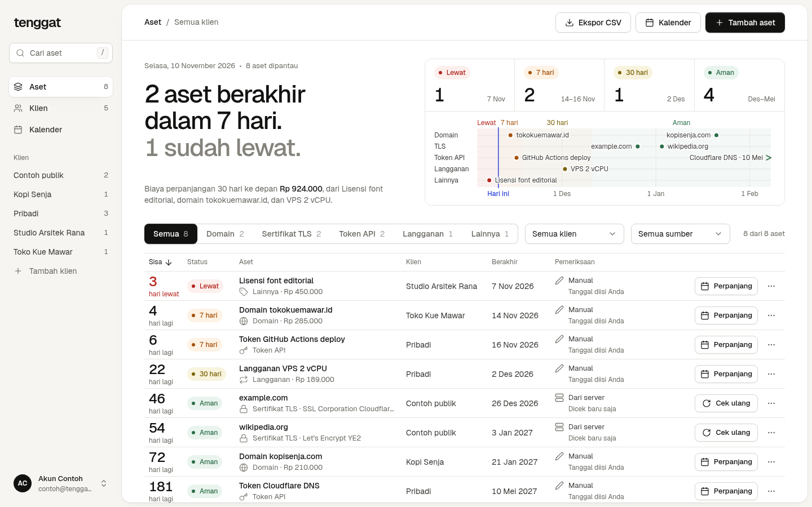
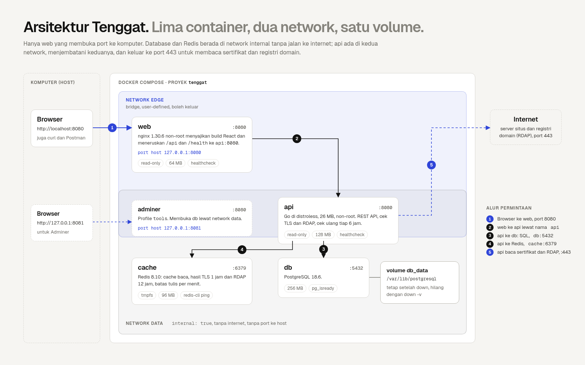
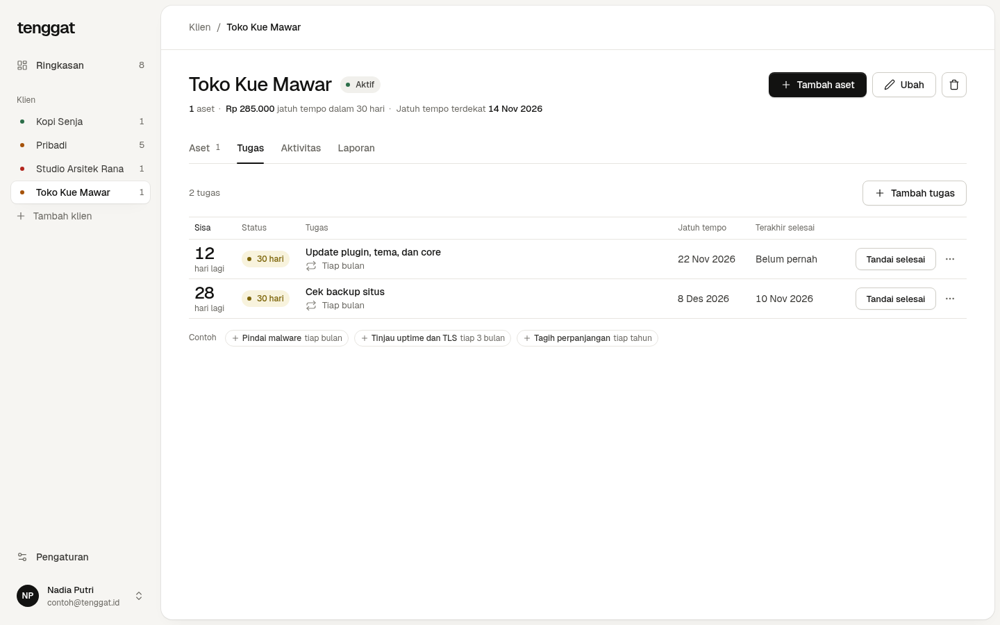
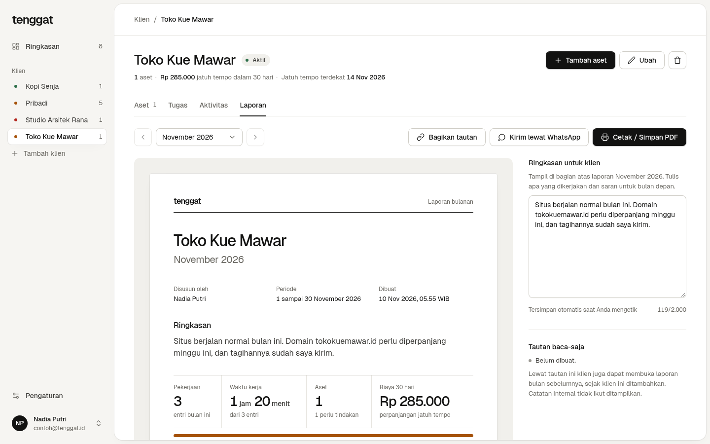
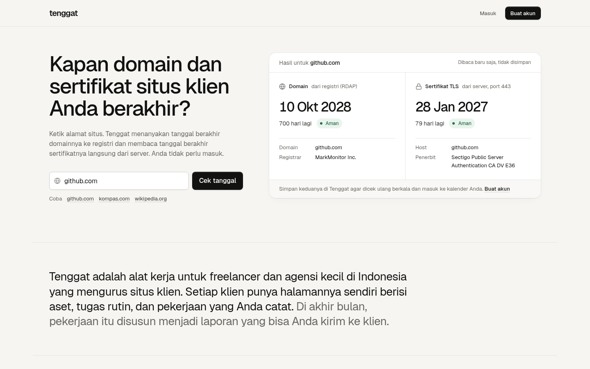
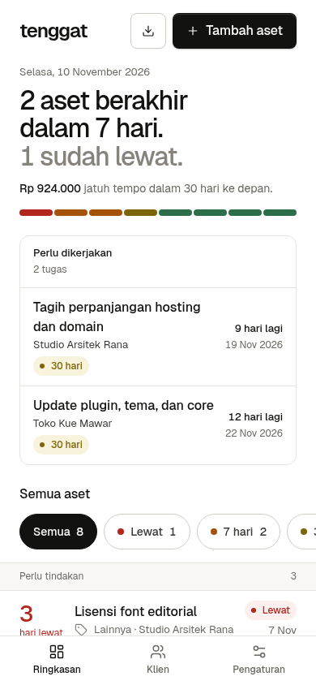
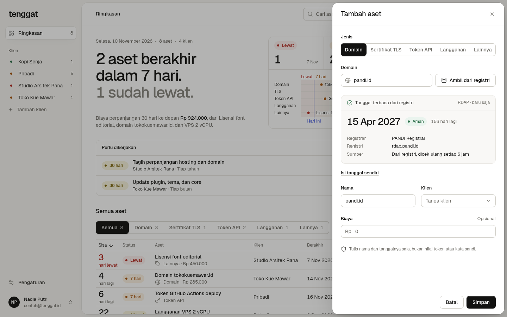

# Tenggat

Tenggat dibuat untuk freelancer dan agensi kecil yang mengurus situs klien. Setiap klien punya halaman sendiri: aset
(domain, sertifikat TLS, token API, langganan) beserta tanggal berakhirnya, tugas maintenance yang berulang, catatan
pekerjaan, dan laporan bulanan yang bisa dikirim ke klien. Tanggal domain dibaca dari registri dan tanggal sertifikat
dari server, lalu dicek ulang tiap 6 jam.

Coba versi online di https://tenggat.mrramdn.com, atau jalankan di komputer Anda sendiri (lihat
[Menjalankan](#menjalankan)).



## Latar belakang

Tanggal berakhir domain, sertifikat, dan token tersebar di email registrar, dashboard penyedia cloud, dan catatan
pribadi. Satu tanggal yang terlewat berarti situs tidak bisa dibuka, browser menampilkan peringatan "Not secure", atau
layanan ditangguhkan. Bagi yang menjual paket maintenance bulanan, ada pekerjaan rutin lain (backup, update plugin,
cek keamanan) dan laporan yang dikirim ke klien tiap bulan, biasanya lewat WhatsApp atau PDF. Tenggat menyatukan
keduanya per klien.

Saya sendiri mengurus VPS, domain, dan beberapa situs klien sebagai freelancer, dan ingin mendalami peran Cloud/DevOps.
Tenggat adalah alat yang saya pakai sendiri untuk masalah ini.

## Fitur

- **Halaman depan** dengan cek langsung: ketik alamat situs, lalu lihat tanggal berakhir domain (registri) dan
  sertifikatnya (server) tanpa membuat akun.
- **Halaman per klien** dengan tab Aset, Tugas, Aktivitas, dan Laporan. Ringkasan lintas klien tetap ada di `/app`.
- **Aset dan tagihan** dengan status dari sisa hari: Lewat, 7 hari, 30 hari, Aman. Domain dibaca lewat RDAP (`.com`,
  `.net`, `.org`, `.id` termasuk `.co.id`, dan TLD lain yang punya RDAP); TLD tanpa RDAP, misalnya `.io`, diisi
  tanggalnya sendiri. Sertifikat dibaca dari port 443. Keduanya dicek ulang berkala, dan kegagalan cek ikut tercatat.
  Jenis **tagihan** mendukung nominal dalam `IDR` atau `USD` (biaya aset dan tugas juga mendukung kedua mata uang,
  dijumlahkan terpisah) serta jadwal berulang. Tombol **Tandai dibayar** (atau **Perpanjang** untuk aset manual)
  memajukan tanggal satu periode dan mencatatnya ke aktivitas — atau langsung melompat ke periode pertama setelah hari
  ini (**Sudah lunas sampai sekarang**) bila sudah tertinggal lebih dari satu periode.
- **Tugas maintenance berulang dan tenggat sekali jalan**, misalnya cek backup tiap bulan untuk klien maupun tenggat
  sekali jalan — termasuk tenggat pribadi tanpa klien langsung dari ringkasan. Setelah ditandai selesai, tugas berulang
  maju ke periode berikutnya, tugas sekali jalan ditutup, dan pekerjaannya masuk ke aktivitas.
- **Agenda gabungan** (`/api/agenda`): daftar terpadu semua aset, tagihan, tugas, dan tenggat aktif urut tanggal
  terdekat, dapat disaring menurut rentang hari, klien, pribadi, status, jenis, atau kata kunci.
- **Aktivitas** per klien: catatan internal, catatan pekerjaan dengan durasi, dan kejadian yang dicatat otomatis (aset
  ditambah atau diperpanjang, tagihan dibayar, tanggal berubah saat cek ulang, tugas selesai).
- **Laporan bulanan** per klien: pekerjaan dan waktu kerja bulan itu, perpanjangan, daftar aset, dan yang jatuh tempo
  60 hari ke depan, plus ringkasan yang Anda tulis. Bisa dicetak atau disimpan sebagai PDF, dibagikan lewat tautan baca-saja yang bisa
  dicabut, atau dikirim lewat WhatsApp. Catatan internal tidak pernah ikut.
- **Pengingat ke klien** lewat WhatsApp untuk aset yang mendekati tanggalnya (tautan `wa.me` berisi teks; nomor telepon
  tidak disimpan).
- **Kalender** `.ics` dengan pengingat 30 dan 7 hari sebelumnya: unduh sekali, atau tautan langganan pribadi supaya
  aplikasi kalender ikut memperbarui sendiri.
- **Ringkasan harian** pukul 08.00 WIB ke Slack, Discord, atau Telegram lewat webhook milik Anda, bila ada aset atau
  tugas yang lewat atau jatuh tempo dalam 7 hari.
- **Token akses pribadi dan MCP**: buat token akses di Pengaturan (cakupan baca saja atau baca dan tulis, dengan masa
  berlaku) untuk memanggil REST API lewat `Authorization: Bearer` atau menghubungkan asisten AI ke endpoint Model
  Context Protocol (`/mcp`).
- Ekspor CSV, akun dengan data terpisah per pengguna, dan penolakan host yang mengarah ke alamat lokal atau privat
  (SSRF).

## Arsitektur



| Service | Image | Port di host | Network | Volume |
|---|---|---|---|---|
| web | `mrramdn/tenggat-web:1.1.0`, build dari `web/` (nginx 1.30.6 unprivileged) | 127.0.0.1:8080 | edge | - |
| api | `mrramdn/tenggat-api:1.1.0`, build dari `api/` (distroless static) | - | edge, data | - |
| db | postgres:18.6-alpine3.24 | - | data | db_data |
| cache | redis:8.10.3-alpine3.23 | - | data | - (tmpfs) |
| adminer (profile `tools`) | adminer:6.3.0 | 127.0.0.1:8081 | edge, data | - |

Hanya `web` yang dibuka ke host. Network `data` bertanda `internal`, jadi database dan Redis tidak punya jalan ke
internet. `api` ada di kedua network: menerima permintaan dari nginx, dan keluar ke port 443 untuk membaca sertifikat,
menanyai registri domain, dan mengirim notifikasi webhook.

## Menjalankan

Butuh Docker Engine dengan Docker Compose.

```bash
git clone https://github.com/mrramdn/tenggat.git
cd tenggat
cp .env.example .env
docker compose up -d --build
```

Buka http://localhost:8080, lalu pilih Buat akun. Untuk mengisi data contoh, `./scripts/isi-data-contoh.sh` membuat
akun `contoh@tenggat.id` dengan kata sandi `contoh-tenggat` (hanya untuk mencoba di komputer Anda) beserta delapan aset,
dua tagihan bulanan (IDR dan USD), empat tugas klien, satu tenggat pribadi sekali jalan, catatan pekerjaan, dan
ringkasan laporan bulan ini.

Image `web` dan `api` juga ada di Docker Hub dengan tag `1.1.0` dan `latest`:
[mrramdn/tenggat-web](https://hub.docker.com/r/mrramdn/tenggat-web) dan
[mrramdn/tenggat-api](https://hub.docker.com/r/mrramdn/tenggat-api). Untuk memakainya tanpa build, ganti perintah
terakhir dengan `docker compose pull web api && docker compose up -d`.

Adminer (opsional): `docker compose --profile tools up -d`, lalu buka http://127.0.0.1:8081. Pilih System
**PostgreSQL**, server `db`, lalu user, kata sandi, dan database dari `.env`.

Data database disimpan di volume `tenggat_db_data`: `docker compose down` mempertahankannya, `docker compose down -v`
menghapusnya.

## Tampilan

| Halaman klien: tugas maintenance | Laporan bulanan |
|---|---|
|  |  |

| Halaman depan dengan cek langsung | Ponsel |
|---|---|
|  |  |

Menambah aset: tanggal domain dibaca dari registri.



## Konfigurasi (`.env`)

| Variabel | Bawaan | Fungsi |
|---|---|---|
| `WEB_PORT` | 8080 | Port di komputer Anda untuk membuka Tenggat |
| `POSTGRES_DB`, `POSTGRES_USER`, `POSTGRES_PASSWORD` | tenggat, tenggat, - | Database; wajib diisi (compose berhenti dengan pesan bila kosong) |
| `CEK_INTERVAL` | 6h | Seberapa sering sertifikat dan domain dicek ulang |
| `BATAS_PER_MENIT` | 30 | Batas permintaan tulis dan cek per pengunjung per menit |
| `MCP_AKTIF` | true | Mengaktifkan endpoint Model Context Protocol di `/mcp` (`true` atau `false`) |
| `APP_URL` | - | Alamat publik aplikasi tanpa garis miring di akhir untuk tautan di notifikasi harian (kosongkan bila lokal) |
| `ADMINER_PORT` | 8081 | Port Adminer (profile `tools`) |

## API

Semua lewat http://localhost:8080 (nginx meneruskan `/api`, `/health`, dan `/mcp` ke `api`). Kecuali yang ditandai
*publik*, setiap endpoint butuh autentikasi lewat sesi (cookie `tenggat_sesi`) atau token akses pribadi lewat header
`Authorization: Bearer <token>`, dan menjawab `401` tanpanya. Token bercakupan `baca` ditolak dengan `403` untuk
permintaan selain `GET`/`HEAD`. Endpoint bertanda *sesi saja* tidak bisa dipanggil dengan token Bearer (`403`):
manajemen token (`/api/token`), hapus akun (`DELETE /api/saya`), ubah/hapus/uji webhook notifikasi (`PUT`, `DELETE
/api/notifikasi`, `POST /api/notifikasi/uji`), serta buat/cabut tautan publik (`/api/kalender/tautan` dan
`/api/klien/{id}/laporan/tautan`). Kesalahan isian dijawab `422` dengan pesan per kolom.

| Method dan path | Fungsi | Status |
|---|---|---|
| `GET /health` (publik) | Kesehatan api, database, dan cache | 200, 503 |
| `GET /api/publik/cek?host=` (publik) | Cek tanggal domain dan sertifikat untuk halaman depan | 200, 422, 429 |
| `POST /api/akun` (publik) | Daftar akun baru dan langsung masuk | 201, 409, 422, 429 |
| `POST /api/sesi` (publik), `DELETE /api/sesi` | Masuk, keluar | 200, 401, 422, 429 / 204 |
| `GET /api/saya`, `DELETE /api/saya` (hapus: *sesi saja*) | Akun yang sedang masuk; hapus akun beserta semua datanya | 200 / 204, 403, 429 |
| `GET /api/agenda?dalam_hari=&klien_id=&pribadi=&status=&jenis=&q=&batas=` | Agenda gabungan aset, tagihan, tugas, dan tenggat aktif, urut tanggal terdekat | 200, 422 |
| `GET /api/item?status=&klien_id=&selesai=1`, `POST /api/item` | Daftar aset/tagihan (`?selesai=1` ikut menampilkan yang sudah ditutup); tambah aset atau tagihan | 200, 422 / 201 + `Location`, 422, 429 |
| `GET`, `PUT`, `DELETE /api/item/{id}` | Satu aset atau tagihan: lihat, ubah, hapus | 200, 404, 409, 422, 429 / 204 |
| `POST /api/item/{id}/cek` | Cek ulang sertifikat atau domain sekarang | 200, 404, 422, 429 |
| `POST /api/item/{id}/perpanjang` | Tandai tagihan dibayar (tutup bila sekali, maju satu periode atau `sampai_kini: true` bila berulang) atau perpanjang aset manual | 200, 404, 409, 422, 429 |
| `GET /api/sertifikat?host=`, `GET /api/domain?host=` | Pratinjau tanggal sebelum disimpan | 200, 422, 429 |
| `GET /api/item.csv`, `GET /api/ringkasan` | Semua aset sebagai CSV; jumlah per status | 200 |
| `GET /api/klien`, `POST /api/klien` | Daftar klien dengan jumlah aset, jatuh tempo terdekat, biaya 30 hari per mata uang; tambah klien | 200 / 201, 409, 422, 429 |
| `PUT`, `DELETE /api/klien/{id}` | Ubah nama, catatan, atau status klien; hapus klien (aset dan tugasnya tetap ada) | 200, 404, 409, 422, 429 / 204 |
| `GET /api/tugas?klien_id=&dalam_hari=&selesai=1`, `POST /api/tugas` | Tugas maintenance berulang dan tenggat sekali jalan (`?selesai=1` ikut menampilkan yang sudah selesai) | 200, 422 / 201 + `Location`, 422, 429 |
| `GET`, `PUT`, `DELETE /api/tugas/{id}`, `POST /api/tugas/{id}/selesai` | Lihat satu tugas, ubah, hapus, tandai selesai (berulang maju ke periode setelah hari ini; sekali jalan ditutup) | 200, 404, 409, 422, 429 / 204 |
| `GET /api/aktivitas?klien_id=&sebelum=`, `POST /api/aktivitas`, `DELETE /api/aktivitas/{id}` | Aktivitas klien; tulis catatan atau pekerjaan; hapus catatan atau pekerjaan | 200 / 201 / 204, 422, 429 |
| `GET /api/klien/{id}/laporan?bulan=`, `PUT /api/klien/{id}/laporan/catatan` | Laporan bulanan; ringkasan Anda untuk bulan itu | 200, 404, 422, 429 |
| `POST`, `DELETE /api/klien/{id}/laporan/tautan` (*sesi saja*) | Buat atau ganti, dan cabut tautan laporan | 201, 403, 404, 429 / 204 |
| `GET /api/laporan/{token}?bulan=` (publik) | Laporan lewat tautan baca-saja | 200, 404, 422, 429 |
| `GET /api/kalender.ics?klien_id=`, `POST`, `DELETE /api/kalender/tautan` (tautan: *sesi saja*) | File kalender; buat atau cabut tautan langganan | 200, 422 / 201, 403, 429 / 204 |
| `GET /api/kalender/{token}.ics` (publik) | Kalender lewat tautan langganan | 200, 404, 429 |
| `GET`, `PUT`, `DELETE /api/notifikasi`, `POST /api/notifikasi/uji` (tulis & uji: *sesi saja*) | Webhook Slack, Discord, atau Telegram; kirim pesan uji | 200, 403, 422, 429, 502 / 204 |
| `GET /api/token`, `POST /api/token`, `DELETE /api/token/{id}` (*sesi saja*) | Daftar, buat (rahasia ditampilkan sekali, maksimal 20), dan cabut token akses pribadi | 200, 403 / 201 + `Location`, 409, 422, 429 / 204, 404 |
| `POST /mcp` (*Bearer token*) | Endpoint Model Context Protocol (Streamable HTTP stateless; `GET`/`DELETE` menjawab `405`) | 200, 401, 404, 405, 429 |

Domain yang dikirim dengan `host` tanpa `kedaluwarsa` dibaca dari registri (`sumber: "registri"`); bila tanggalnya
diisi, aset itu manual. Aset dan tugas menerima `klien_id` atau `klien` (nama); nama yang belum ada menjadi klien baru.

Contoh dengan curl (cookie sesi disimpan di `sesi.txt`):

```bash
curl -i -c sesi.txt -X POST http://localhost:8080/api/akun \
  -H 'Content-Type: application/json' \
  -d '{"nama":"Rifki","email":"rifki@contoh.id","kata_sandi":"minimal-delapan"}'

curl -i -b sesi.txt -X POST http://localhost:8080/api/item \
  -H 'Content-Type: application/json' \
  -d '{"jenis":"domain","klien":"Pribadi","host":"mrramdn.com"}'

curl -i -b sesi.txt -X POST http://localhost:8080/api/tugas \
  -H 'Content-Type: application/json' \
  -d '{"klien":"Toko Kue Mawar","judul":"Cek backup situs","ulang_jumlah":1,"ulang_satuan":"bulan","jatuh_tempo":"2026-12-01"}'
```

`GET /api/item`, `GET /api/ringkasan`, `GET /api/klien`, `GET /api/tugas`, dan `GET /api/agenda` membawa header
`X-Cache: HIT` atau `MISS` dari Redis.

## MCP

Endpoint `/mcp` menyediakan alat Model Context Protocol (Streamable HTTP) agar asisten AI dapat membaca agenda, mengecek
host, serta menambah atau menandai aset, tagihan, dan tugas langsung atas nama akun Anda. Server MCP memanggil REST API
secara internal dengan hak akses token yang sama, sehingga batas cakupan dan isolasi data per akun tetap berlaku.

Untuk mulai, buka **Pengaturan** → **Token akses**, klik **Buat token**, lalu isi nama dan pilih cakupannya. Cakupan
wajib dipilih sendiri setiap kali membuat token: pilih **Baca dan tulis** untuk alat yang akan menambah, mengubah, atau
menandai data, atau **Baca saja** bila hanya membaca. Masa berlaku bawaannya **90 hari** (bisa diganti ke 30 hari, 365
hari, atau tanpa batas), dan nilai tokennya hanya ditampilkan sekali.

Tambahkan server MCP Tenggat ke klien Anda (ganti `<token>` dengan token yang baru dibuat):

```bash
claude mcp add --transport http tenggat https://tenggat.mrramdn.com/mcp --header "Authorization: Bearer <token>"
agy mcp add --header "Authorization: Bearer <token>" tenggat https://tenggat.mrramdn.com/mcp
kiro-cli mcp add --name tenggat --url https://tenggat.mrramdn.com/mcp
```

Baris pertama untuk Claude Code, baris kedua untuk `agy`, dan baris ketiga untuk Kiro. Untuk Kiro (belum diuji),
tambahkan URL-nya dengan `kiro-cli mcp add --name tenggat --url https://tenggat.mrramdn.com/mcp` lalu masukkan header
`Authorization: Bearer <token>` di berkas `mcp.json`-nya.

Daftar sepuluh alat yang tersedia di `/mcp` (token **Baca saja** hanya melihat tiga alat baca):

| Alat | Fungsi | Akses |
|---|---|---|
| `agenda` | Daftar aset, tagihan, tugas, dan tenggat aktif urut tanggal terdekat beserta jumlah per status; bisa disaring menurut rentang hari, klien, pribadi, status, jenis, atau kata kunci | Baca |
| `daftar_klien` | Daftar klien dengan jumlah aset, tanggal jatuh tempo terdekat, dan biaya 30 hari per mata uang (`IDR`, `USD`) | Baca |
| `cek_host` | Cek langsung tanggal berakhir domain (RDAP) dan sertifikat TLS sebuah host tanpa menyimpan apa pun | Baca |
| `tambah_item` | Tambah aset atau tagihan (`sertifikat`, `domain`, `token`, `langganan`, `tagihan`, atau `lainnya`) beserta biaya, mata uang, dan jadwal berulang | Tulis |
| `tambah_tugas` | Tambah tugas maintenance berulang atau tenggat sekali jalan (`sekali: true`), untuk klien maupun pribadi | Tulis |
| `ubah_item` | Ubah sebagian kolom pada aset atau tagihan berdasarkan `id` tanpa menghapus kolom lain | Tulis |
| `ubah_tugas` | Ubah sebagian kolom pada tugas atau tenggat berdasarkan `id` tanpa menghapus kolom lain | Tulis |
| `selesaikan` | Tandai tugas selesai (`asal: "tugas"`), atau tandai tagihan dibayar / aset manual diperpanjang (`asal: "item"`, mendukung `sampai_kini`) | Tulis |
| `catat_pekerjaan` | Catat pekerjaan (`pekerjaan`, masuk laporan klien) atau catatan internal (`catatan`) di aktivitas | Tulis |
| `hapus` | Hapus permanen satu aset/tagihan (`asal: "item"`) atau satu tugas/tenggat (`asal: "tugas"`) berdasarkan `id` | Tulis |

Contoh kalimat yang bisa Anda ucapkan ke asisten:

- "Apa saja yang jatuh tempo dalam 14 hari ke depan?"
- "Tambahkan tagihan bulanan langganan cloud sebesar US$20 jatuh tempo tanggal 15 bulan depan."
- "Tandai tagihan internet fiber sudah lunas sampai sekarang."

## Data dan privasi

- Yang disimpan: nama dan email akun, hash kata sandi, sesi, token akses pribadi (hash saja), klien (nama, catatan,
  status), aset dan tagihan (nama, jenis, host, tanggal, biaya, mata uang, jadwal ulang, catatan), tugas, dan aktivitas.
  Tenggat tidak pernah meminta atau menyimpan token dan kata sandi dari aset yang dilacak.
- Satu-satunya rahasia yang disimpan adalah URL webhook notifikasi yang Anda isi sendiri. URL itu hanya dipakai untuk
  mengirim ringkasan harian dan pesan uji, tidak pernah ditampilkan utuh atau ditulis ke log, dan terhapus saat notifikasi dimatikan atau
  akun dihapus.
- Catatan klien dan aktivitas bisa memuat nama kontak; isi seperlunya. Catatan internal tidak pernah masuk laporan.
- Tautan laporan dan tautan kalender berisi token acak. Database hanya menyimpan SHA-256-nya, tautannya bisa diganti atau
  dicabut kapan saja, dan halaman laporan meminta mesin pencari tidak mengindeksnya.
- Token akses pribadi (`tgt_...`) hanya disimpan sebagai hash SHA-256 dan nilai rahasianya hanya ditampilkan sekali saat
  dibuat. Setiap token dibatasi cakupannya (`baca` atau `tulis`), memiliki masa berlaku (bawaan 90 hari, bisa dicabut
  kapan saja), dan tidak pernah dapat mengelola token lain, menghapus akun, mengubah atau menguji webhook notifikasi,
  maupun mengubah tautan kalender dan laporan publik.
- Kata sandi disimpan sebagai hash Argon2id. Token sesi acak 256 bit, database hanya menyimpan SHA-256-nya, cookie-nya
  `HttpOnly` dan `SameSite=Lax` (dan `Secure` di HTTPS), berlaku 30 hari, dan dicabut saat keluar.
- Untuk membaca tanggal, api menghubungi server situs dan registri domain; yang dikirim hanya nama host atau domain.
  Cek di halaman depan tidak menyimpan apa pun.
- Permintaan yang mengubah data dari situs lain ditolak (`403`). Masuk, daftar, tulis, dan cek dibatasi per pengunjung.
- Hapus akun menghapus akun, sesi, token akses, klien, aset, tugas, aktivitas, dan pengaturan notifikasi sekaligus.

## Pengembangan

```bash
cd api && go test ./...            # Go 1.26 atau lebih baru (uji PostgreSQL dilewati tanpa TENGGAT_UJI_PG=1)
cd web && pnpm install && pnpm dev # Vite meneruskan /api ke http://localhost:8080
```

Untuk ikut menjalankan pengujian integrasi terhadap PostgreSQL sungguhan (setiap pengujian membuat skema sementara
sendiri lalu menghapusnya saat selesai), nyalakan PostgreSQL lalu set `TENGGAT_UJI_PG=1` beserta variabel `PG*`:

```bash
cd api && TENGGAT_UJI_PG=1 PGHOST=localhost PGPORT=5432 PGUSER=postgres PGPASSWORD=postgres PGDATABASE=postgres PGSSLMODE=disable go test -race -count=1 ./...
```

CI GitHub Actions (`.github/workflows/ci.yml`) menjalankan pengujian PostgreSQL ini (bersama `gofmt` dan `go vet`) serta
`pnpm typecheck` dan `pnpm build` pada setiap push ke `main` dan pull request.

## Struktur folder

```
api/        layanan Go: cmd/server, internal/{expiry,tlscheck,rdap,store,cache,auth,httpapi,mcpserver,uang}, Dockerfile
web/        React + Vite + TypeScript, nginx.conf, Dockerfile
scripts/    isi-data-contoh.sh untuk data contoh
docs/       diagram, screenshot README, dan salinan artikel (GitHub Pages)
docker-compose.yml, .env.example
```

## Kredit

- [pgx](https://github.com/jackc/pgx), [go-redis](https://github.com/redis/go-redis), [x/crypto](https://pkg.go.dev/golang.org/x/crypto) (Argon2id), [x/net](https://pkg.go.dev/golang.org/x/net) (publicsuffix, idna)
- Data bootstrap RDAP dari [IANA](https://data.iana.org/rdap/dns.json), disalin ke `api/internal/rdap/dns.json`
- [React](https://react.dev), [TypeScript](https://www.typescriptlang.org), [Vite](https://vite.dev) dengan
  [@vitejs/plugin-react](https://github.com/vitejs/vite-plugin-react), [TanStack Query](https://tanstack.com/query)
- Huruf [Geist dan Geist Mono](https://vercel.com/font) (SIL Open Font License 1.1, `web/src/assets/fonts/OFL.txt`)
- Ikon dari [Lucide](https://lucide.dev) (ISC)
- Image dasar resmi: golang, node, nginxinc/nginx-unprivileged, gcr.io/distroless/static, postgres, redis, adminer
- Definisi tipe dari [DefinitelyTyped](https://github.com/DefinitelyTyped/DefinitelyTyped) (`@types/react`, `@types/react-dom`)
- Tanpa starter resmi: kerangka `api/` dan `web/` ditulis sendiri sejak commit pertama (`5362979`).

## AI Usage Declaration

- **Alat:** Claude (Anthropic), lewat Claude Code.
- **Bagian yang dibantu dan hasilnya:**
  1. **Brainstorming dan perluasan ide.** AI memberi beberapa usulan topik dari masalah saya sendiri, lalu saya memilih
     Tenggat: pengingat tanggal berakhir domain, sertifikat, token, dan langganan. Setelah versi pertama terasa terlalu
     dasar, AI mengusulkan pengembangannya menjadi halaman per klien dengan tugas maintenance, catatan pekerjaan,
     laporan bulanan, dan pengingat.
  2. **Pembuatan kode.** AI membantu membuat draf kode api dalam Go (status, cek sertifikat dan RDAP, endpoint, akun,
     cache Redis), web dalam React dan TypeScript, Dockerfile, docker-compose.yml, nginx.conf, dan skrip data contoh,
     lalu memperbaikinya dari hasil pengujian. AI juga membuat beberapa mockup tampilan, dan saya yang memilih arahnya.
     Keputusan akhir dan penjelasan setiap baris Dockerfile dan docker-compose.yml di video adalah milik saya.
  3. **Penyusunan laporan.** AI membantu menyusun draf jawaban Soal 1 dan 2, README, artikel, naskah video, dan catatan
     arti setiap baris Dockerfile dan docker-compose.yml yang saya pakai untuk belajar.
- **Yang saya kerjakan sendiri:** menentukan masalah, topik, dan batasannya (tanpa API key, Go untuk api, React
  terpisah, Redis dan Docker Hub untuk bonus), memilih arah desain, meninjau hasil dan meminta perbaikan, menyiapkan
  akun Docker Hub serta DNS dan sertifikat untuk versi online, lalu merekam dan menarasikan video.
- **Contoh prompt utama:**
  - "Dari masalah yang aku alami sendiri: klien banyak dan datanya berantakan, sering lupa perpanjang domain,
    sertifikat, dan langganan. Bantu cari ide aplikasi web untuk UTS ini yang benar-benar kepakai."
  - "Fiturnya masih terlalu dasar. Kembangkan jadi halaman per klien: aset, tugas maintenance rutin, catatan
    pekerjaan, dan laporan bulanan untuk klien. Bantu juga Dockerfile dan docker-compose.yml-nya, sekalian jelaskan
    tiap barisnya."
  - "Susun draf laporan dan README dari hasil kerja dan bukti yang sudah ada. Bahasanya formal tapi tidak kaku."

## Tautan

- Artikel: https://www.mrramdn.com/en/blog/tenggat (salinan: https://mrramdn.github.io/tenggat/)
- Video demo: https://youtu.be/I8MUjNdjYa8
- Docker Hub: https://hub.docker.com/r/mrramdn/tenggat-api dan https://hub.docker.com/r/mrramdn/tenggat-web
- Versi online: https://tenggat.mrramdn.com
