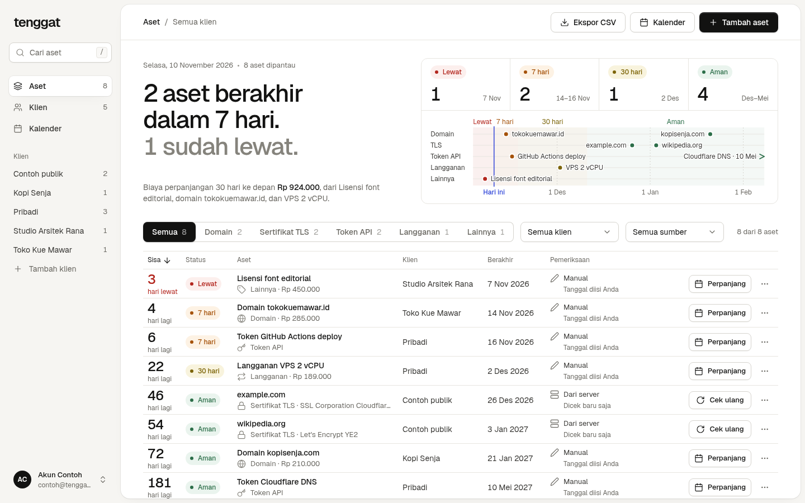
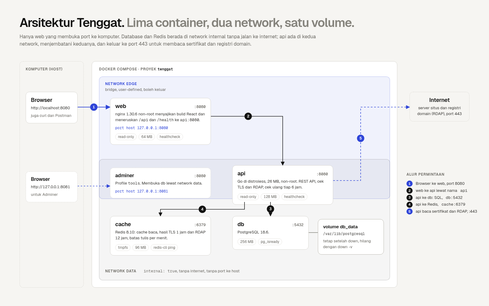
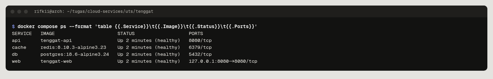

Small web projects often die a quiet death: a domain renewal email lands in a folder nobody reads, a TLS certificate
stops renewing, or an API token expires on a Friday night. The dates exist, but they are scattered across registrar
emails, cloud dashboards and notes. I look after my own VPS, domains, API tokens and client websites, so I built
**Tenggat** (Indonesian for "deadline"): one list of expiry dates, with certificate dates read straight from the
servers.



## What it does

You add an asset: a domain, a TLS certificate, an API token or a subscription. For a certificate you only type the
host; the API connects on port 443, reads the real end date and re-checks it every six hours. Each item gets a status
from the days left (Lewat, 7 hari, 30 hari, Aman), and a calendar export (.ics) puts reminders on your phone. Every
user has an account and sees only their own assets. Tenggat stores names and dates, never secret values, and keeps
passwords as Argon2id hashes.

## Architecture



Five containers run under Docker Compose:

- **web**: nginx serving the React build and proxying `/api`; the only container with a host port (`127.0.0.1:8080`).
- **api**: Go on a distroless image; the only container that reaches the internet, to read certificates.
- **db**: PostgreSQL 18 with its data on a named volume.
- **cache**: Redis 8 as a pure cache for reads, certificate lookups and rate limits.
- **adminer**: a database UI that only starts with `--profile tools`.

Two user-defined networks separate them. `edge` connects web, api and the outside world; `data` is marked
`internal: true`, so the database and Redis have no route to the internet and no published port. The API sits on both
and reaches its neighbours by service name (`db`, `cache`), never by IP.

## The Dockerfile

```dockerfile
FROM golang:1.27.3-alpine3.24 AS build
WORKDIR /src
ENV CGO_ENABLED=0 GOOS=linux
COPY go.mod go.sum ./
RUN go mod download
COPY . .
RUN go build -trimpath -ldflags="-s -w" -o /out/server ./cmd/server

FROM gcr.io/distroless/static-debian13:nonroot@sha256:25ac8f0c... AS runtime
WORKDIR /app
COPY --from=build /out/server /app/server
EXPOSE 8080
USER nonroot:nonroot
HEALTHCHECK CMD ["/app/server", "healthcheck"]
ENTRYPOINT ["/app/server"]
```

The dependency files are copied before the source, so changing code does not re-download modules. The build stage is
808 MB; the image that ships is **25 MB**, because only the static binary crosses into the runtime stage. Distroless
has no shell and no curl, so the binary checks its own health with a `healthcheck` subcommand, and it has no version
tags, so it is pinned by digest.

## Compose: start in the right order

```yaml
api:
  build: ./api
  environment:
    PGHOST: db
    PGPASSWORD: ${POSTGRES_PASSWORD:?Salin .env.example ke .env}
    REDIS_ADDR: cache:6379
  depends_on:
    db:
      condition: service_healthy
    cache:
      condition: service_healthy
  networks: [edge, data]

db:
  image: postgres:18.6-alpine3.24
  volumes:
    - db_data:/var/lib/postgresql
  healthcheck:
    test: ["CMD-SHELL", "pg_isready -U $$POSTGRES_USER -d $$POSTGRES_DB"]
  networks: [data]
```

`condition: service_healthy` waits until PostgreSQL accepts connections, not just until its container has started.
`${VAR:?message}` stops Compose with a clear message when `.env` is missing, instead of starting a database with an
empty password.

## Run it

```bash
git clone https://github.com/mrramdn/tenggat.git && cd tenggat
cp .env.example .env
docker compose up -d --build
```

Open http://localhost:8080. `docker compose down` keeps the data in the `tenggat_db_data` volume; `docker compose down
-v` deletes it.



## Redis earns its place

Certificate lookups are cached per host for an hour, so a repeat lookup dropped from 257 ms to 6 ms. List and summary
reads carry an `X-Cache: HIT/MISS` header, and every write bumps a version number so stale entries are never read.
Writes are limited to 30 a minute per client; the next one gets `429` with `Retry-After`.

## What I learned

- **PostgreSQL 18 moved its data directory.** The official image stores data under `/var/lib/postgresql`; mounting
  the volume at the old `/var/lib/postgresql/data` path is a trap.
- **nginx resolves upstream names once.** Docker's DNS (`resolver 127.0.0.11`) with a variable upstream lets nginx
  find the API again after its container is recreated.
- **Accounts change the privacy story.** With names and emails stored, the app falls under Indonesia's personal data
  law (UU 27/2022): data minimisation, a working "delete account", hashed passwords, and a 3×24-hour breach notice.
- **User input that triggers network calls is an attack surface.** The certificate check refuses loopback, private
  and link-local addresses, so it cannot probe the internal Docker network (SSRF).

The code is on GitHub: [github.com/mrramdn/tenggat](https://github.com/mrramdn/tenggat), the images on Docker Hub
(`mrramdn/tenggat-api`, `mrramdn/tenggat-web`), and a public instance at [tenggat.mrramdn.com](https://tenggat.mrramdn.com).
